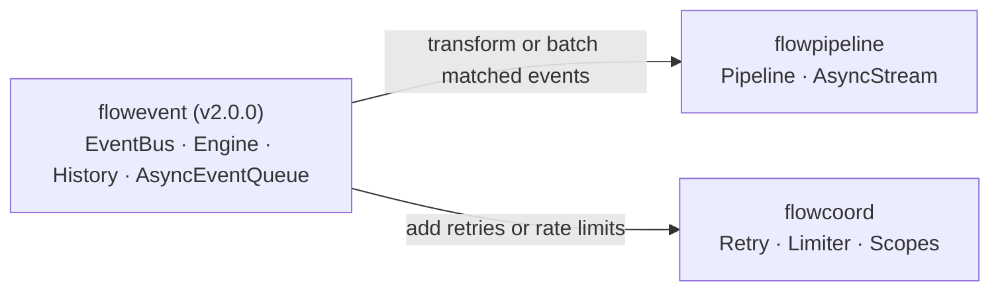

# FlowEvent English Documentation

`flowevent` is a zero-dependency library for **in-process** event delivery in Python applications and libraries, offering both thread-safe synchronous and `asyncio`-native buses. It lets you publish typed objects, route subscribers by key (`routing_key`), replay bounded event history without losing live events, and bridge background threads to an `asyncio` loop safely—without setting up an external broker.

> **Scope note:** `flowevent` delivers events within a single Python process. It does not replace cross-machine durable message brokers such as Kafka, RabbitMQ, or Redis Streams.

---

## Table of Contents

- [Where Should You Start?](#where-should-you-start)
- [Documentation Map](#documentation-map)
- [Choosing the Right Component](#choosing-the-right-component)
- [Ecosystem Role](#ecosystem-role)

---

## Where Should You Start?

- New to `flowevent`? Begin with [01 · Getting Started and Architecture](getting-started.md) to see why plain observer lists break down in production and run your first sync and async examples.
- For thread-safe synchronous publishing, indexed `routing_key` merging order, atomic `once`/`times` claims, `ErrorPolicy`, and lifecycle hooks, read [02 · Synchronous EventBus and Routing](sync-bus-and-routing.md).
- For `AsyncEventBus` (`DeliveryMode.CONCURRENT` + `max_concurrency`), named channels (`EventEngine` / `AsyncEventEngine`), and cross-thread `AsyncEventQueue` bridging, jump to [03 · Async EventBus, Channel Engines, and Bridges](async-bus-engine-and-bridges.md).
- For `MemoryEventHistory` (`block_size`), race-free `replay` buffering, `EventFilter`, `SubscriptionScope`, `CallbackSubscription`, and `correlation_context`, read [04 · History, Filtering, Scopes, and Context](history-filtering-scopes-and-context.md).
- To understand the optional `flowevent._core` C extension, pure-Python fallback toggles, and free-threaded GIL safeguards, see [05 · Performance and C Core](performance-and-c-core.md).
- For full signatures, parameter defaults, and the `EventBusError` hierarchy, consult [06 · API Reference](api-reference.md).

[Back to top](#table-of-contents)

---

## Documentation Map

| Guide | Contents |
| --- | --- |
| **[01 · Getting Started and Architecture](getting-started.md)** | Installation, "Why FlowEvent?", process boundaries, `PublishResult` / `EventBusStats`, and quick examples. |
| **[02 · Synchronous EventBus and Routing](sync-bus-and-routing.md)** | Indexed `routing_key`, registration-order merge, `once`/`times`, `ErrorPolicy`, `EventBusActions`, `executor`, `wait_for`, `publish_every`. |
| **[03 · Async EventBus, Channel Engines, and Bridges](async-bus-engine-and-bridges.md)** | `AsyncEventBus`, `SEQUENTIAL` vs `CONCURRENT` + `max_concurrency`, `publish_threadsafe`, `EventEngine` / `AsyncEventEngine`, and `AsyncEventQueue`. |
| **[04 · History, Filtering, Scopes, and Context](history-filtering-scopes-and-context.md)** | `MemoryEventHistory` (`block_size`), replay buffer safety, `EventFilter`, `SubscriptionScope`, `CallbackSubscription`, `EventEnvelope`, and `ContextVar`. |
| **[05 · Performance and C Core](performance-and-c-core.md)** | `flowevent._core` acceleration boundaries, `EVENTFLOW_*` environment toggles, free-threaded GIL checks, and `pyperf` benchmarks. |
| **[06 · API Reference](api-reference.md)** | All 38 public exports, constructors, methods, stats dataclasses, and the `EventBusError` tree. |

[Back to top](#table-of-contents)

---

## Choosing the Right Component

| Use Case | Component | Why? |
| --- | --- | --- |
| Synchronous code or cross-thread notifications | `EventBus` | Thread-safe dispatch, optional C core acceleration, zero hidden event loops. |
| Coroutine handlers inside an existing `asyncio` loop | `AsyncEventBus` | Runs directly on your event loop with optional `max_concurrency` bounds. |
| Separating unrelated domains into named buses | `EventEngine` / `AsyncEventEngine` | Isolated per-channel buses with centralized `start`/`stop`/`close`. |
| Passing events from worker threads into an `asyncio` consumer | `AsyncEventQueue` | Bounded deque, backpressure (`overflow`), and early filtering without spawning per-publish tasks. |
| Replaying recent events to late subscribers without drops | `MemoryEventHistory` + `replay=...` | Buffers live arrivals while replaying history, then switches cleanly to live stream. |

[Back to top](#table-of-contents)

---

## Ecosystem Role

- `flowevent` has zero required dependencies and installs standalone.
- Compose with **FlowPipeline** for structured processing/streaming and **FlowCoord** for retries, rate limiting, and execution scopes.

[Back to top](#table-of-contents)

---

**Next:** [01 · Getting Started and Architecture →](getting-started.md)
