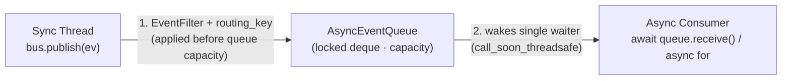

[← Documentation Map](README.md) · [Previous: 02 · Synchronous EventBus](sync-bus-and-routing.md) · [Next: 04 · History, Filtering, and Scopes →](history-filtering-scopes-and-context.md)

# 03 · Async EventBus, Channel Engines, and Bridges

This guide covers coroutine dispatch via `AsyncEventBus`, named channel coordination with `EventEngine` / `AsyncEventEngine`, and bounded thread-to-async delivery with `AsyncEventQueue`.

---

## Table of Contents

- [`AsyncEventBus` and Single-Loop Ownership](#asynceventbus-and-single-loop-ownership)
  - [`DeliveryMode.SEQUENTIAL` vs `DeliveryMode.CONCURRENT` and `max_concurrency`](#deliverymodesequential-vs-deliverymodeconcurrent-and-max_concurrency)
  - [Publishing from Threads via `publish_threadsafe()`](#publishing-from-threads-via-publish_threadsafe)
- [`EventEngine` and `AsyncEventEngine` Named Channels](#eventengine-and-asynceventengine-named-channels)
- [`AsyncEventQueue`: Thread ↔ Asyncio Bridge](#asynceventqueue-thread--asyncio-bridge)
  - [Backpressure (`overflow`) Policies](#backpressure-overflow-policies)
  - [Pre-Queue Filtering and `EventQueueObserver`](#pre-queue-filtering-and-eventqueueobserver)
- [Common Pitfalls](#common-pitfalls)

---

## `AsyncEventBus` and Single-Loop Ownership

`AsyncEventBus` is purely `asyncio`-native—not a thread pool wrapper. It binds to the first running event loop on which it operates (`_bind_loop`) and rejects cross-loop access immediately with `RuntimeError`.

### `DeliveryMode.SEQUENTIAL` vs `DeliveryMode.CONCURRENT` and `max_concurrency`

| Mode | Behavior | When to Use |
| --- | --- | --- |
| `DeliveryMode.SEQUENTIAL` *(default)* | Awaits matching handlers one after another in registration order without spawning tasks. | Ordered delivery, low overhead, predictable execution. |
| `DeliveryMode.CONCURRENT` | Runs matching handlers concurrently. | Handlers perform independent network or I/O awaits. |

**Why `max_concurrency` matters:** Without a limit, concurrent delivery can spawn one task per matching subscriber. Setting `max_concurrency=16` keeps at most 16 delivery tasks active for each publish. Separate publish calls have separate limits.

```python
import asyncio
from flowevent import AsyncEventBus, DeliveryMode


async def main() -> None:
    seen: list[int] = []

    async def worker(value: int) -> None:
        await asyncio.sleep(0.01)
        seen.append(value)

    async with AsyncEventBus[int](
        delivery_mode=DeliveryMode.CONCURRENT,
        max_concurrency=4,
    ) as bus:
        for _ in range(8):
            await bus.subscribe(worker)
        result = await bus.publish(42)

    assert result.delivered == 8
    assert len(seen) == 8


asyncio.run(main())
```

### Publishing from Threads via `publish_threadsafe()`

From a worker thread, call `bus.publish_threadsafe(event)` to get a `concurrent.futures.Future[PublishResult]`. First use the bus on its owning event loop and keep that loop running. Wait on the future from the worker thread, since blocking on it in the event-loop thread prevents delivery. For sustained streams, consider `AsyncEventQueue`.

[Back to top](#table-of-contents)

---

## `EventEngine` and `AsyncEventEngine` Named Channels

Rather than mixing unrelated domain events on one bus, `EventEngine` and `AsyncEventEngine` manage separate buses under readable channel names (`"orders"`, `"telemetry"`, `"audit"`):

- Subscribing with `engine.subscribe("orders", handler)` (or awaiting it on the async engine) creates the channel with engine defaults if it is missing.
- To customize a channel (e.g., attaching a `routing_key` extractor or custom `EventHistory`), instantiate an `EventBus` and register it with `engine.add("orders", bus)`. One open bus cannot belong to two live engines simultaneously.
- `engine.stop()` / `await engine.close()` closes all registered channels; if any channel fails to close, it stays tracked for retry.

```python
from flowevent import EventEngine

received: list[str] = []
with EventEngine(history=10) as engine:
    engine.subscribe("auth", received.append)
    engine.publish("auth", "user.logged_in")

assert received == ["user.logged_in"]
```

[Back to top](#table-of-contents)

---

## `AsyncEventQueue`: Thread ↔ Asyncio Bridge

When hardware callbacks, blocking libraries, or worker threads emit events that an `asyncio` application consumes, bridge them with **`AsyncEventQueue`**:



**Why `AsyncEventQueue` beats per-event `publish_threadsafe` for streams?**
- Publishing onto the queue **never spawns an `asyncio` task**. Events enqueue under one lock and wake at most one waiting consumer.
- Events published before the async consumer begins reading are preserved up to `capacity`.

### Backpressure (`overflow`) Policies

When the queue reaches `capacity` (default `128`), `overflow` controls what happens:

| Policy | Behavior | Typical Use |
| --- | --- | --- |
| `"error"` *(default)* | Rejects the new item. The bus reports a `QueueOverflowError` in `PublishResult.errors` under `ISOLATE`, or in an `ExceptionGroup` under `RAISE`. | Streams where the publisher must detect overflow. |
| `"drop_oldest"` | Evicts the oldest queued item to admit the newest (`dropped` increments). | Telemetry or UI state where freshest state wins. |
| `"drop_newest"` | Discards the incoming event (`dropped` increments). | FIFO streams where older entries have priority. |

### Pre-Queue Filtering and `EventQueueObserver`

`AsyncEventQueue(bus, event_type=..., predicate=..., routing_key=...)` filters events **at subscription time** so rejected events never consume bounded queue slots. Attach an `observer` implementing `EventQueueObserver.record(...)` to observe `queue_depth`, `dropped`, and `rejected` outside the queue lock.

Observer exceptions are logged through `flowevent.bridges`. They leave acceptance, delivery and the overflow policy intact.

```python
import asyncio
import threading
from flowevent import AsyncEventQueue, EventBus


async def main() -> None:
    with EventBus[str]() as bus:
        async with AsyncEventQueue(bus, capacity=8, overflow="drop_oldest") as queue:
            thread = threading.Thread(target=lambda: bus.publish("ping"))
            thread.start()
            thread.join()
            item = await queue.receive()
    assert item == "ping"


asyncio.run(main())
```

[Back to top](#table-of-contents)

---

## Common Pitfalls

| Mistake | Effect | Fix |
| --- | --- | --- |
| Awaiting `queue.receive()` concurrently from multiple tasks | Raises `RuntimeError` (single-consumer contract). | Use one consumer task or create a separate `AsyncEventQueue` per consumer. |
| Sharing an `AsyncEventBus` across different event loops | Raises `RuntimeError` on cross-loop calls. | Construct and operate each `AsyncEventBus` within one loop lifecycle. |
| Skipping engine `stop()` / `close()` | Scheduled background publishers keep running. | Always use `with EventEngine() as engine:` or `async with AsyncEventEngine()`. |

[Back to top](#table-of-contents)

---

**Previous:** [02 · Synchronous EventBus and Routing](sync-bus-and-routing.md) · **Next:** [04 · History, Filtering, Scopes, and Context →](history-filtering-scopes-and-context.md)
