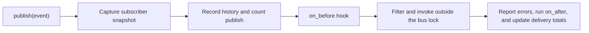

[← Documentation Map](README.md) · [Previous: 01 · Getting Started](getting-started.md) · [Next: 03 · Async EventBus, Engines, and Bridges →](async-bus-engine-and-bridges.md)

# 02 · Synchronous EventBus and Routing

This guide covers `EventBus` thread safety, indexed `routing_key` dispatch, finite delivery claims (`once` / `times`), error policies (`ErrorPolicy`), lifecycle hooks (`EventBusActions`), and `executor` / `wait_for` / `publish_every`.

---

## Table of Contents

- [Publish Flow and Concurrency Model](#publish-flow-and-concurrency-model)
- [How Indexed `routing_key` Routing Works](#how-indexed-routing_key-routing-works)
  - [Registration-Order Preservation Across Wildcards and Keys](#registration-order-preservation-across-wildcards-and-keys)
- [Delivery Limits: `once` and `times`](#delivery-limits-once-and-times)
- [Error Policy (`ErrorPolicy`) and Hooks (`EventBusActions`)](#error-policy-errorpolicy-and-hooks-eventbusactions)
- [`executor`, `wait_for`, and `publish_every`](#executor-wait_for-and-publish_every)
- [Common Pitfalls](#common-pitfalls)

---

## Publish Flow and Concurrency Model

Calling `bus.publish(event)` executes in a well-defined sequence:



**Lock-free delivery invocation:** Subscribers are executed *outside* the bus `RLock`. A handler can cancel its subscription or publish another event without holding the bus lock. Code inside a handler still needs to account for its own locks and blocking calls.

[Back to top](#table-of-contents)

---

## How Indexed `routing_key` Routing Works

Scanning hundreds or thousands of unrelated subscriber predicates on every publish wastes `O(N)` work. Configuring `EventBus(..., routing_key=extractor)` maintains separate hash-indexed subscriber maps alongside wildcards:

- `bus.subscribe(cb, routing_key="orders")`: Invoked only when `extractor(event) == "orders"`; publishes for `"billing"` never touch `"orders"` subscribers.
- `bus.subscribe(cb)` (`routing_key=None`): A **wildcard** subscriber that receives events regardless of key.

### Registration-Order Preservation Across Wildcards and Keys

Many routers fire all keyed subscribers first and all wildcards afterward, breaking registration order. `flowevent` assigns monotonically increasing subscriber IDs and merges keyed + wildcard indexes in **linear two-pointer order** (cached per key), guaranteeing exact registration order:

```python
from flowevent import EventBus

order: list[str] = []
with EventBus[tuple[str, int]](routing_key=lambda e: e[0]) as bus:
    bus.subscribe(lambda e: order.append("w1"))
    bus.subscribe(lambda e: order.append("k1"), routing_key="orders")
    bus.subscribe(lambda e: order.append("w2"))
    bus.subscribe(lambda e: order.append("other"), routing_key="billing")
    bus.publish(("orders", 1))

assert order == ["w1", "k1", "w2"]  # Exact registration order preserved; "billing" skipped
```

Note: Using `routing_key` on `subscribe()`, `once()`, or `wait_for()` requires a `routing_key` extractor on the `EventBus`; otherwise `ValueError` is raised. Routing keys must be `Hashable`.

[Back to top](#table-of-contents)

---

## Delivery Limits: `once` and `times`

- `bus.once(cb)` / `bus.subscribe(cb, once=True)`: Atomically guarantees delivery to **at most one matching event**, even under racing multi-threaded publishers.
- `bus.subscribe(cb, times=3)`: Delivers to at most `3` matching events (`once=True` cannot be combined with `times != 1`).
- **Pre-dispatch failure recovery:** If claiming a slot succeeds in `executor` mode before dispatch starts and pre-execution setup fails, the claim is restored (`restore_claim`); once the handler itself runs, raising an exception counts as an attempted delivery.

[Back to top](#table-of-contents)

---

## Error Policy (`ErrorPolicy`) and Hooks (`EventBusActions`)

| Policy | Behavior |
| --- | --- |
| `ErrorPolicy.ISOLATE` *(default)* | All remaining subscribers still run even if one fails. Exceptions are collected in `PublishResult.errors` and passed to `on_error`. |
| `ErrorPolicy.RAISE` | Delivery continues for other selected subscribers. If errors were collected, `publish()` raises an `ExceptionGroup`, even for a single failure. |

Provide `EventBusActions` (or direct `on_before`, `on_after`, `on_error`, `on_timeout` kwargs—never both) for cross-cutting hooks. An `on_before` failure is captured into errors without aborting subscriber dispatch. All `EventBus` hooks must be **synchronous**.

[Back to top](#table-of-contents)

---

## `executor`, `wait_for`, and `publish_every`

- **`executor` (`ThreadPoolExecutor`):** Offloads matching callback invocations to the thread pool while `publish()` waits for completion so `PublishResult` reflects real outcomes. Best suited for I/O-heavy handlers rather than sub-microsecond callbacks.
- **`wait_for(..., timeout=...)`:** Blocks cleanly on a condition variable until a matching event arrives or `timeout` elapses (`None` waits indefinitely; `0` checks deadline immediately). On timeout, calls `on_timeout` and returns `None`.
- **`publish_every(event, interval, *, times=None, immediately=True)`:** Runs periodic publishes on daemon threads (capped at `max_schedules`, default `64`, raising `RuntimeError` at capacity). Calling `bus.close()` stops schedules within `shutdown_timeout` (default `5.0` s) or raises `EventShutdownTimeoutError`.

[Back to top](#table-of-contents)

---

## Common Pitfalls

| Mistake | Effect | Fix |
| --- | --- | --- |
| Passing `async def` to `EventBus.subscribe` | Raises `InvalidEventHandlerError` (a `TypeError` subclass). | Use `AsyncEventBus` or bridge via `AsyncEventQueue`. |
| Subscribing with `routing_key=...` without a bus extractor | Raises `ValueError`. | Initialize `EventBus(routing_key=...)`. |
| Starting `publish_every` without closing the bus | Background schedule threads keep running until process exit. | Always use `with EventBus() as bus:` or call `bus.close()`. |

[Back to top](#table-of-contents)

---

**Previous:** [01 · Getting Started and Architecture](getting-started.md) · **Next:** [03 · Async EventBus, Channel Engines, and Bridges →](async-bus-engine-and-bridges.md)
