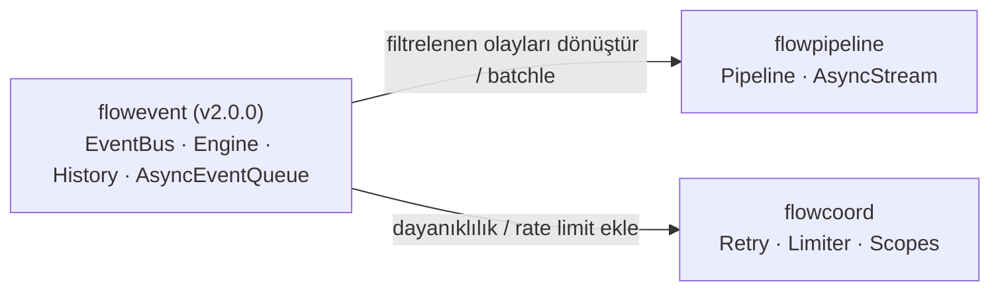

# FlowEvent Türkçe Belgeleri

`flowevent`, Python uygulamaları ve kütüphaneleri için süreç içi (`in-process`) çalışan, senkron ve `asyncio`-yerel (async-native) bir olay dağıtım kütüphanesidir. Harici bir mesaj broker'ı (Redis, RabbitMQ, Kafka) kurmadan tipli olaylar yayımlamanı, anahtar bazlı yönlendirme (`routing_key`) yapmanı, sınırlı geçmişten olay oynatmanı (`replay`) ve thread ↔ event loop arasında güvenli köprüler kurmanı sağlar.

> **Kapsam Notu:** `flowevent` yalnızca tek bir Python süreci içinde olay teslimi yapar. Makineler arası kalıcı mesajlaşma veya ağ üzerinden dağıtık kuyruk yerine geçmez.

---

## Konu Dizini

- [Nereden Başlamalısın?](#nereden-başlamalısın)
- [Doküman Haritası](#doküman-haritası)
- [Hangi Bileşeni Seçmelisin?](#hangi-bileşeni-seçmelisin)
- [Ekosistemdeki Yeri](#ekosistemdeki-yeri)

---

## Nereden Başlamalısın?

- İlk kez kullanıyorsan [01 · Başlangıç ve Mimari Felsefe](getting-started.md) ile başla. Basit callback listelerinin neden üretimde sorun çıkardığını, mimari sınırları ve ilk senkron/asenkron örneği görürsün.
- Thread-safe yayın, indeksli `routing_key` birleştirme sırası, tek-seferlik teslim atomikliği (`once` / `times`), hata politikaları (`ErrorPolicy`) ve yaşam döngüsü hook'ları için [02 · Senkron EventBus ve Yönlendirme](sync-bus-and-routing.md) rehberini oku.
- Asenkron `DeliveryMode.CONCURRENT` + `max_concurrency`, isimlendirilmiş kanallar (`EventEngine` / `AsyncEventEngine`) ve thread ↔ asyncio köprüsü (`AsyncEventQueue`) için [03 · Asenkron EventBus, Channel Engine ve Köprüler](async-bus-engine-and-bridges.md) sayfasına geç.
- Sınırlı olay geçmişi (`MemoryEventHistory` ve bloklu yapı), replay tamponlama, `EventFilter`, `SubscriptionScope`, `CallbackSubscription` ve `correlation_context` için [04 · Geçmiş, Filtreleme, Scope ve Context](history-filtering-scopes-and-context.md) rehberine bak.
- İsteğe bağlı C çekirdeği (`flowevent._core`), saf Python geri dönüşü ve free-threaded Python detayları için [05 · Performans ve C Çekirdeği](performance-and-c-core.md) sayfasını incele.
- Tüm sınıf imzaları ve istisna hiyerarşisi için [06 · API Başvuru Kartı](api-reference.md) kullan.

[Yukarı dön](#konu-dizini)

---

## Doküman Haritası

| Doküman | İçerik |
| --- | --- |
| **[01 · Başlangıç ve Mimari Felsefe](getting-started.md)** | Kurulum, "Neden FlowEvent?", süreç içi sınırlar, `PublishResult` ve `EventBusStats`, ilk senkron/asenkron örnekler. |
| **[02 · Senkron EventBus ve Yönlendirme](sync-bus-and-routing.md)** | İndeksli `routing_key`, kayıt sırası garantisi, `once`/`times`, `ErrorPolicy`, `EventBusActions`, `executor`, `wait_for`, `publish_every`. |
| **[03 · Asenkron EventBus, Engine ve Köprüler](async-bus-engine-and-bridges.md)** | `AsyncEventBus`, `SEQUENTIAL` vs `CONCURRENT` + `max_concurrency`, `publish_threadsafe`, `EventEngine` / `AsyncEventEngine` ve `AsyncEventQueue`. |
| **[04 · Geçmiş, Filtreleme, Scope ve Context](history-filtering-scopes-and-context.md)** | `MemoryEventHistory` (`block_size`), `replay` tamponu, `EventFilter`, `SubscriptionScope`, `CallbackSubscription`, `EventEnvelope` ve `ContextVar`. |
| **[05 · Performans ve C Çekirdeği](performance-and-c-core.md)** | `flowevent._core` hızlandırma sınırları, `FLOWEVENT_*` ortam değişkenleri, free-threaded GIL koruması ve `pyperf` benchmark kullanımı. |
| **[06 · API Başvuru Kartı](api-reference.md)** | 38 public dışa aktarım, kurucular, metotlar, istatistik veri sınıfları ve `EventBusError` hiyerarşisi. |

[Yukarı dön](#konu-dizini)

---

## Hangi Bileşeni Seçmelisin?

| Senaryo | Doğru Bileşen | Neden? |
| --- | --- | --- |
| Senkron kod veya thread'ler arasında olay dağıtımı | `EventBus` | Thread-safe yayın, opsiyonel C çekirdeği hızlandırması ve gizli event loop yok. |
| Zaten `asyncio` event loop'unda koşan async işleyiciler | `AsyncEventBus` | Coroutine işleyicileri doğrudan aynı loop'ta çalıştırır; eşzamanlılık `max_concurrency` ile sınırlanabilir. |
| Farklı modüllerin / bileşenlerin ayrı kanallara sahip olması | `EventEngine` / `AsyncEventEngine` | Kanal isimleriyle izole bus yönetimi ve toplu başlatma/durdurma sağlar. |
| Arka plan thread'lerinin ürettiği olayları `asyncio` tüketicisine aktarmak | `AsyncEventQueue` | Her `publish()` için task açmadan bounded kuyruk, geri basınç (`overflow`) ve erken filtreleme sunar. |
| Her olay değil yalnızca geçmişten sorgu veya geç gelen aboneye son N olayı vermek | `MemoryEventHistory` + `replay=...` | Abonelik sırasında canlı olayları kaçırmadan önce geçmişi oynatır, sonra canlı akışa geçer. |

[Yukarı dön](#konu-dizini)

---

## Ekosistemdeki Yeri

- `flowevent` sıfır dış bağımlılıklıdır; tek başına kurulur.
- Olay işleme zincirleri ve akış (`batch_within`, `buffer`) için **FlowPipeline**, gelişmiş yeniden deneme/devre kesici/hız sınırları için **FlowCoord** ile birleştirilebilir.

[Yukarı dön](#konu-dizini)

---

**Sonraki:** [01 · Başlangıç ve Mimari Felsefe →](getting-started.md)
