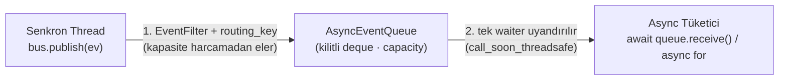

[← Belge Haritası](README.md) · [Önceki: 02 · Senkron EventBus](sync-bus-and-routing.md) · [Sonraki: 04 · Geçmiş, Filtreleme ve Scope →](history-filtering-scopes-and-context.md)

# 03 · Asenkron EventBus, Channel Engine ve Köprüler

Bu rehber coroutine işleyiciler için `AsyncEventBus`, modüler kanal yönetimi için `EventEngine` / `AsyncEventEngine` ve thread ↔ event loop sınırını güvenli kılan `AsyncEventQueue` köprüsünü anlatır.

---

## Konu Dizini

- [`AsyncEventBus` ve Tek-Loop Sahipliği](#asynceventbus-ve-tek-loop-sahipliği)
  - [`DeliveryMode.SEQUENTIAL` vs `DeliveryMode.CONCURRENT` ve `max_concurrency`](#deliverymodesequential-vs-deliverymodeconcurrent-ve-max_concurrency)
  - [`publish_threadsafe()` ile Thread'den Yayın](#publish_threadsafe-ile-threadden-yayın)
- [`EventEngine` ve `AsyncEventEngine` ile İsimli Kanallar](#eventengine-ve-asynceventengine-ile-i%CC%87simli-kanallar)
- [`AsyncEventQueue`: Thread ↔ Asyncio Köprüsü](#asynceventqueue-thread--asyncio-köprüsü)
  - [Geri Basınç (`overflow`) Politikaları](#geri-basınç-overflow-politikaları)
  - [Erken Filtreleme ve `EventQueueObserver`](#erken-filtreleme-ve-eventqueueobserver)
- [Sık Yapılan Hatalar](#sık-yapılan-hatalar)

---

## `AsyncEventBus` ve Tek-Loop Sahipliği

`AsyncEventBus`, thread havuzu kullanan sahte bir async wrapper değil; **tamamen `asyncio`-yerel** bir event bus'tır. İlk kullanıldığı çalışan event loop'a bağlanır (`_bind_loop`) ve farklı bir loop'tan kullanılmaya çalışılırsa hemen `RuntimeError` yükseltir.

### `DeliveryMode.SEQUENTIAL` vs `DeliveryMode.CONCURRENT` ve `max_concurrency`

| Mod | Davranış | Ne Zaman Seçilmeli? |
| --- | --- | --- |
| `DeliveryMode.SEQUENTIAL` *(varsayılan)* | Eşleşen aboneleri kayıt sırasıyla arka arkaya `await` eder; yeni task oluşturmaz. | Sıralı tutarlılık, düşük overhead ve öngörülebilir yürütme istendiğinde. |
| `DeliveryMode.CONCURRENT` | Eşleşen aboneleri aynı anda yürütür. | Aboneler ağ/DB gibi bağımsız I/O beklemeleri yapıyorsa. |

**Neden `max_concurrency` önemlidir?** Sınır verilmezse eşleşen her abone için bir görev oluşturulabilir. `max_concurrency=16`, her yayının aynı anda en fazla 16 dağıtım görevi çalıştırmasını sağlar. Ayrı yayın çağrılarının sınırları birbirinden bağımsızdır.

```python
import asyncio
from flowevent import AsyncEventBus, DeliveryMode


async def main() -> None:
    seen: list[int] = []

    async def worker(value: int) -> None:
        await asyncio.sleep(0.01)
        seen.append(value)

    async with AsyncEventBus[int](
        delivery_mode=DeliveryMode.CONCURRENT,
        max_concurrency=4,
    ) as bus:
        for _ in range(8):
            await bus.subscribe(worker)
        result = await bus.publish(42)

    assert result.delivered == 8
    assert len(seen) == 8


asyncio.run(main())
```

### `publish_threadsafe()` ile Thread'den Yayın

Arka plan thread’inden `bus.publish_threadsafe(event)` çağrısı bir `concurrent.futures.Future[PublishResult]` döndürür. Önce bus’ı kendi event loop’unda kullan ve döngüyü çalışır durumda tut. Sonucu arka plan thread’inde bekle. Event loop’un çalıştığı thread’i bloke etmek dağıtımı engeller. Sürekli akışlar için `AsyncEventQueue` kullanabilirsin.

[Yukarı dön](#konu-dizini)

---

## `EventEngine` ve `AsyncEventEngine` ile İsimli Kanallar

Büyük uygulamalarda farklı modüllerin olaylarını tek torbaya atmak yerine `"orders"`, `"telemetry"`, `"audit"` gibi adlandırılmış kanallara ayırmak istersin. `EventEngine` ve `AsyncEventEngine` her kanal adı için ayrı bir `EventBus` / `AsyncEventBus` tutar:

- `engine.subscribe("orders", handler)` çağrısı `"orders"` kanalı henüz yoksa varsayılan ayarlarla otomatik oluşturur.
- Bir kanala özel `routing_key` veya farklı `history` boyutu vermek istersen kendi bus'ını oluşturup `engine.add("orders", bus)` ile kaydedebilirsin (aynı açık bus iki farklı engine'e eklenemez).
- `engine.stop()` (asenkron motorda `await engine.close()` / `async with`) tüm açık kanalları kapatır; kapanışı başarısız olan kanalları silmeyip yeniden denenebilmek için takip etmeye devam eder. `engine.start()` ile motor tekrar açılabilir.

```python
from flowevent import EventEngine

received: list[str] = []
with EventEngine(history=10) as engine:
    engine.subscribe("auth", received.append)
    engine.publish("auth", "user.logged_in")

assert received == ["user.logged_in"]
```

[Yukarı dön](#konu-dizini)

---

## `AsyncEventQueue`: Thread ↔ Asyncio Köprüsü

Donanım sürücüsü, `threading.Thread` veya blocking bir kütüphane olay üretirken, ana uygulamanın `asyncio` event loop'unda tüketmesi gerektiğinde **`AsyncEventQueue`** kullanılır:



**Neden `publish_threadsafe` yerine `AsyncEventQueue`?**
- `bus.publish(ev)` asla `asyncio` task'ı oluşturmaz; olayı tek kilitli sınırlı `deque` içine koyar ve bekleyen tüketici varsa uyandırır.
- Tüketici bağlanmadan önce yayınlanan olaylar bile (kapasite dahilinde) kuyrukta tutulur.

### Geri Basınç (`overflow`) Politikaları

Kuyruk `capacity` (varsayılan `128`) sınırına ulaştığında ne olacağını `overflow` belirler:

| Politika | Davranış | Kullanım Senaryosu |
| --- | --- | --- |
| `"error"` *(varsayılan)* | Yeni öğeyi reddeder. Bus, `ISOLATE` politikasında `QueueOverflowError` hatasını `PublishResult.errors` içinde, `RAISE` politikasında ise `ExceptionGroup` içinde bildirir. | Yayıncının taşmayı algılaması gereken akışlar. |
| `"drop_oldest"` | En eski bekleyen olayı çıkarıp yenisini ekler (`dropped` artar). | Telemetri / UI durumu gibi "en taze veri önemli" akışlar. |
| `"drop_newest"` | Yeni gelen olayı atar, kuyruktakileri korur (`dropped` artar). | İlk gelen sıranın korunması gereken kuyruklar. |

### Erken Filtreleme ve `EventQueueObserver`

`AsyncEventQueue(bus, event_type=..., predicate=..., routing_key=...)` doğrudan abonelik seviyesinde filtre uygular; böylece **ilgisiz olaylar bounded kuyruk kapasitesini tüketmeden** elenir. `observer` vererek `event_queue.publish` ve `event_queue.receive` adımında kuyruk derinliği (`queue_depth`) ve düşen olay sayacı (`dropped`, `rejected`) izlenebilir.

Gözlemci istisnaları `flowevent.bridges` üzerinden loglanır. Olay kabulü, teslimatı ve taşma politikası uygulanmaya devam eder.

```python
import asyncio
import threading
from flowevent import AsyncEventQueue, EventBus


async def main() -> None:
    with EventBus[str]() as bus:
        async with AsyncEventQueue(bus, capacity=8, overflow="drop_oldest") as queue:
            thread = threading.Thread(target=lambda: bus.publish("ping"))
            thread.start()
            thread.join()
            item = await queue.receive()
    assert item == "ping"


asyncio.run(main())
```

[Yukarı dön](#konu-dizini)

---

## Sık Yapılan Hatalar

| Hata | Ne Olur? | Doğrusu |
| --- | --- | --- |
| `AsyncEventQueue` üzerinden aynı anda iki task'tan `receive()` çağırmak | Tek-tüketici sözleşmesi nedeniyle `RuntimeError` fırlatılır. | Tek bir tüketici task kullan veya her tüketiciye kendi `AsyncEventQueue` örneğini aç. |
| `AsyncEventBus`'ı `asyncio.run(...)` dışında oluşturup başka loop'ta kullanmak | İlk bound olunan loop dışındaki çağrıda `RuntimeError` alır. | `AsyncEventBus` oluşturma, abone olma ve yayın işlemlerini aynı event loop içinde tut. |
| `EventEngine` açık kanalları kapatmadan programı sonlandırmak | Periyodik zamanlayıcılar varsa kaynaklar açık kalır. | `with EventEngine() as engine:` (veya `async with AsyncEventEngine()`) kalıbını kullan. |

[Yukarı dön](#konu-dizini)

---

**Önceki:** [02 · Senkron EventBus ve Yönlendirme](sync-bus-and-routing.md) · **Sonraki:** [04 · Geçmiş, Filtreleme, Scope ve Context →](history-filtering-scopes-and-context.md)
