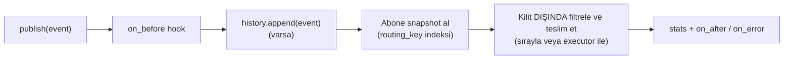

[← Belge Haritası](README.md) · [Önceki: 01 · Başlangıç](getting-started.md) · [Sonraki: 03 · Asenkron EventBus, Engine ve Köprüler →](async-bus-engine-and-bridges.md)

# 02 · Senkron EventBus, Yönlendirme ve Hata Politikaları

Bu rehber senkron `EventBus` sınıfının iş parçacığı güvenliğini (thread-safety), anahtar bazlı yönlendirme (`routing_key`) mimarisini, teslim sınırlarını, hata politikalarını, yaşam döngüsü hook'larını ve `executor` kullanımını anlatır.

---

## Konu Dizini

- [Yayın Akışı ve Eşzamanlılık Modeli](#yayın-akışı-ve-eşzamanlılık-modeli)
- [Anahtar Bazlı Yönlendirme (`routing_key`) Nasıl Çalışır?](#anahtar-bazlı-yönlendirme-routing_key-nasıl-çalışır)
  - [Wildcard ve Keyed Aboneliklerde Sıra Garantisi](#wildcard-ve-keyed-aboneliklerde-sıra-garantisi)
- [Teslim Sınırları: `once` ve `times`](#teslim-sınırları-once-ve-times)
- [Hata Politikası (`ErrorPolicy`) ve Hook'lar (`EventBusActions`)](#hata-politikası-errorpolicy-ve-hooklar-eventbusactions)
- [`executor`, `wait_for` ve `publish_every`](#executor-wait_for-ve-publish_every)
- [Sık Yapılan Hatalar](#sık-yapılan-hatalar)

---

## Yayın Akışı ve Eşzamanlılık Modeli

`bus.publish(event)` çağrıldığında olay sırayla şu aşamalardan geçer:



**Kritik tasarım tercihi (Kilit dışında teslimat):** Callback'ler bus kilidi **tutulmadan** çalıştırılır. Böylece bir abone kendi içinden `subscription.cancel()` veya `bus.publish(...)` çağırdığında deadlock yaşanmaz; abonelik snapshot'ı tutarlı kalır.

[Yukarı dön](#konu-dizini)

---

## Anahtar Bazlı Yönlendirme (`routing_key`) Nasıl Çalışır?

Binlerce abonenin olduğu bir sistemde her olayda tüm abonelerin filtrelerini çalıştırmak `O(N)` maliyet üretir. `EventBus(..., routing_key=extractor)` verdiğinde kütüphane aboneleri dahili olarak indeksler:

- `bus.subscribe(cb, routing_key="orders")`: Yalnızca `extractor(event) == "orders"` olan olaylarda değerlendirilir; `"billing"` veya `"metrics"` olaylarında hiç ziyaret edilmez.
- `bus.subscribe(cb)` (`routing_key=None`): **Wildcard (genel)** abonedir; anahtardan bağımsız tüm olayları görür.

### Wildcard ve Keyed Aboneliklerde Sıra Garantisi

Birçok kütüphanede indeksleme yapıldığında önce tüm anahtarlılar, sonra tüm wildcard'lar (veya tam tersi) çalışır ve kayıt sırası bozulur. `flowevent` her aboneye artan bir `id` verir ve anahtar snapshot'ı oluştururken wildcard + keyed indekslerini **kayıt sırasını koruyarak** doğrusal iki-işaretçili (two-pointer) birleştirmeyle birleştirir:

```python
from flowevent import EventBus

order: list[str] = []
with EventBus[tuple[str, int]](routing_key=lambda e: e[0]) as bus:
    bus.subscribe(lambda e: order.append("w1"))
    bus.subscribe(lambda e: order.append("k1"), routing_key="orders")
    bus.subscribe(lambda e: order.append("w2"))
    bus.subscribe(lambda e: order.append("other"), routing_key="billing")
    bus.publish(("orders", 1))

assert order == ["w1", "k1", "w2"]  # Kayıt sırası birebir korunur, "billing" atlanır
```

Not: Aboneliklerde `routing_key` kullanmak için `EventBus` kurucusunda `routing_key` çıkarıcı tanımlı olmalıdır; aksi halde `subscribe(..., routing_key=...)` `ValueError` fırlatır. Ayrıca `routing_key` hash'lenebilir (`Hashable`) olmalıdır.

[Yukarı dön](#konu-dizini)

---

## Teslim Sınırları: `once` ve `times`

- `bus.once(cb)` veya `bus.subscribe(cb, once=True)`: Aboneliğin **tam olarak 1 eşleşen teslimattan sonra** atomik olarak devre dışı kalmasını garanti eder. İki thread aynı anda `publish()` etse bile yalnızca bir thread talebi (claim) kazanır; iki kez teslimat olmaz.
- `bus.subscribe(cb, times=3)`: Aboneliği en fazla `3` eşleşen olay için etkin tutar (`once=True` ile `times != 1` birlikte verilemez).
- **Önemli detay:** Eğer `executor` kullanılan bir sistemde teslimat öncesi talep alındıktan sonra yürütme aşamasına geçilemezse hak geri yüklenir (`restore_claim`); ancak callback çalıştırılıp kendi içinde hata fırlattıysa hak harcanmış sayılır (yeniden denenmez).

[Yukarı dön](#konu-dizini)

---

## Hata Politikası (`ErrorPolicy`) ve Hook'lar (`EventBusActions`)

| Politika | Davranış |
| --- | --- |
| `ErrorPolicy.ISOLATE` *(varsayılan)* | Bir abonede hata olsa bile kalan abonelerin tamamı çalıştırılır. Hatalar toplanıp `PublishResult.errors` içinde döndürülür ve varsa `on_error` hook'una verilir. |
| `ErrorPolicy.RAISE` | Hatalar yine sonraki aboneleri engellemeden toplanır (ve `on_error` tetiklenir), ancak `publish()` sonunda tek hata varsa doğrudan kendisi, birden fazla hata varsa `ExceptionGroup("Event dispatch failed", errors)` yükseltilir. |

`EventBusActions` (veya doğrudan kurucudaki `on_before`, `on_after`, `on_error`, `on_timeout` parametreleri) tüm yayınlara ortak gözlem veya yan etki bağlamayı sağlar. `on_before` içinde hata çıkarsa o yayın iptal edilmez, diğer adımlar çalışır ve hata toplanır. Tüm hook'lar **senkron** olmalıdır.

[Yukarı dön](#konu-dizini)

---

## `executor`, `wait_for` ve `publish_every`

- **`executor` (`ThreadPoolExecutor`):** Verilirse teslimatlar iş havuzuna gönderilir ve `publish()` mevcut yayın görevlerinin bitmesini bekler (`PublishResult` gerçek sonuçlarla döner). Yalnızca callback gövdelerini paralel çalıştırmak istediğiniz I/O işlerinde kullanın; kısa callback'lerde thread geçişi maliyeti faydayı aşabilir.
- **`wait_for(..., timeout=...)`:** Belirli bir filtreye veya `routing_key`'e uyan ilk olayı bloklayarak bekler (`timeout=None` süresiz, `timeout=0` yalnızca bekleme olmadan zaman aşımı). Süre dolarsa `on_timeout` hook'u çağrılır ve `None` döner.
- **`publish_every(event, interval, *, times=None, immediately=True)`:** Arka planda daemon thread üzerinde periyodik yayın yapar (`max_schedules` varsayılan 64 ile sınırlıdır; dolunca `RuntimeError` verir). `bus.close()` çağrıldığında zamanlanmış yayınlar `shutdown_timeout` (varsayılan `5.0` sn) içinde durdurulur; durmazsa `EventShutdownTimeoutError` fırlatır.

[Yukarı dön](#konu-dizini)

---

## Sık Yapılan Hatalar

| Hata | Ne Olur? | Doğrusu |
| --- | --- | --- |
| `EventBus.subscribe` içine `async def` vermek | `InvalidEventHandlerError` (`TypeError` alt sınıfı) fırlatılır. | `AsyncEventBus` veya `AsyncEventQueue` kullan. |
| `EventBus()` üzerinde `routing_key` tanımlamadan `subscribe(..., routing_key="x")` çağırmak | `ValueError` yükselir. | `EventBus(routing_key=lambda e: ...)` ile oluştur. |
| `bus.close()` çağrılmadan `publish_every` başlatıp çıkmak | Arka plan zamanlayıcı thread'i sürecin kapanmasına kadar yayın yapmaya devam edebilir. | Her zaman `with EventBus() as bus:` kullan veya açıkça `bus.close()` çağır. |

[Yukarı dön](#konu-dizini)

---

**Önceki:** [01 · Başlangıç ve Mimari Felsefe](getting-started.md) · **Sonraki:** [03 · Asenkron EventBus, Channel Engine ve Köprüler →](async-bus-engine-and-bridges.md)
